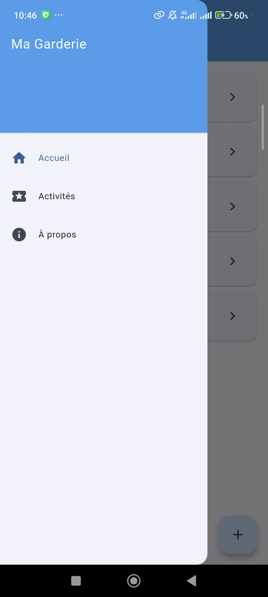

# Ma Garderie

Application mobile pour une garderie d'enfants, développée avec Flutter. Elle présente la liste des activités proposées aux enfants. Les données sont déclarées localement dans le code : il n'y a ni backend, ni base de données, ni authentification.

## Fonctionnalités

- Splash screen avec l'image d'accueil, le nom de l'application et une transition automatique vers la page principale après 3 secondes
- Page principale avec une AppBar, un Drawer (Accueil, Activités, À propos) et un bouton flottant `+`
- Liste des activités avec icône, titre et description, dans des cartes
- Interactions : message « Nouvelle activité » sur le bouton `+`, titre de l'activité dans un SnackBar au clic, sélection des entrées du Drawer

## Technologies utilisées

- Flutter et Dart
- Material Design (widgets Material 3)
- Git et GitHub (une branche par fonctionnalité, fusionnée dans `main`)

## Installation et exécution

Prérequis : Flutter installé (vérifier avec `flutter doctor`) et un émulateur ou un téléphone Android connecté.

```bash
git clone https://github.com/Eya-Ben-Belgacem/garderie-mobile.git
cd garderie-mobile
flutter pub get
flutter run
```

## Structure du projet

```
lib/
├── main.dart                  # point d'entrée, thème, écran de démarrage
└── screens/
    ├── splash_screen.dart     # écran de démarrage (3 secondes)
    └── home_page.dart         # page principale, liste et interactions
assets/images/splash.png       # image d'accueil
```

## Captures d'écran

### Splash Screen


### Page principale avec la liste des activités


### Drawer ouvert


### Message affiché après une interaction


## Organisation Git

Chaque étape a été réalisée dans une branche séparée, suivie d'un commit puis d'une fusion dans `main` :
`feature/init-project`, `feature/splash-screen`, `feature/home-page`, `feature/list-view`, `feature/interactions`, `docs/readme`.

## Auteur

Eya Ben Belgacem